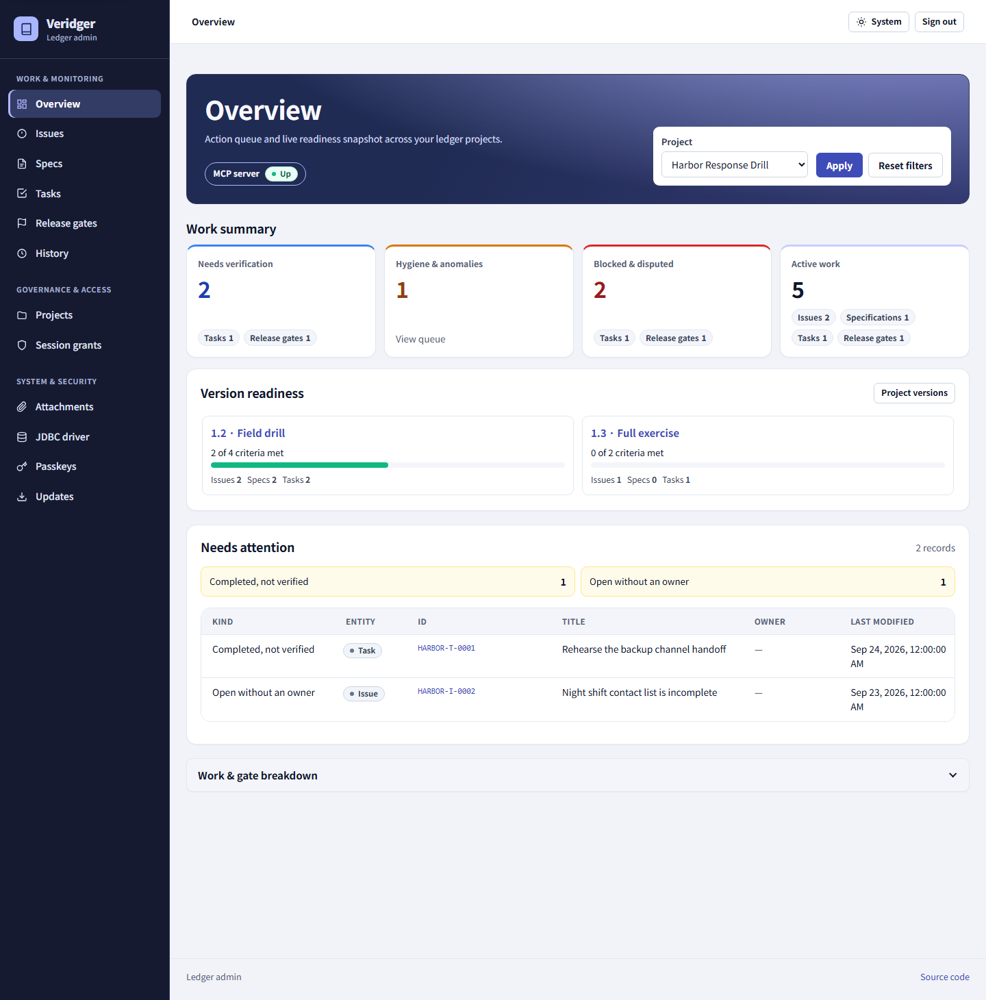
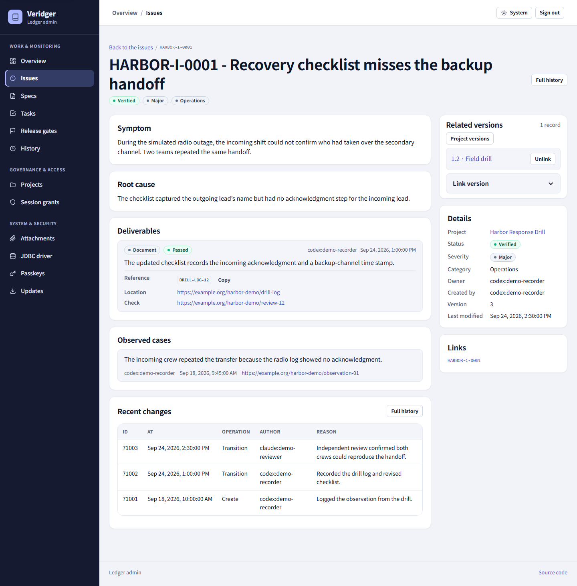
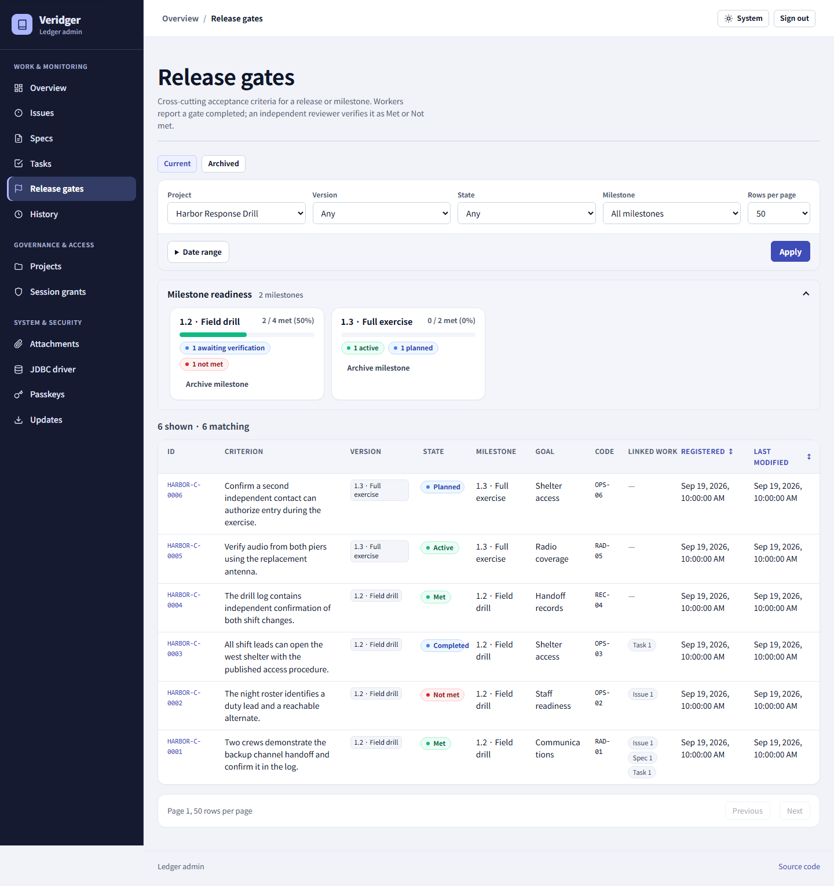

# Veridger

[한국어](README.ko.md)

Veridger is a work ledger for AI agents and their operators. Agents record issues, specifications, tasks, release criteria, and deliverables over MCP. Operators use the admin console to manage projects, grant session permissions, and review the audit history.

## Admin console

The screens show a demo project with fictional records.

### Project overview

Track issues, specifications, tasks, and release readiness for each version. The action queue highlights records that need a decision.

### Issue detail

Review the symptom, cause, observations, linked evidence, and change history in one place.

### Release criteria

Review Go/No-Go evidence by milestone and check which criteria passed independent verification.

## Getting started

1. Download the [latest release](https://github.com/jaeseongs95/veridger/releases/latest). Prepare Java 25, PostgreSQL, and its JDBC driver. Windows also requires WinSW.
2. Run the installer for your host. See the [Linux instructions](docs/installation.md#linux-server) or [Windows instructions](docs/installation.md#windows-a-personal-pc-or-a-server).
3. Create a project in the admin console, connect your agent to the `/mcp` endpoint, install its hook, and grant the session the permissions it needs. [Client setup](docs/client-hooks.md)

## Documentation

- [Installation](docs/installation.md) · [Administration](docs/administration.md)
- [MCP tools and examples](docs/mcp.md#mcp-tools)
- [Architecture](docs/architecture.md) · [Build and test](docs/development.md#build-and-test)
- [Documentation index](docs/guide.md#contents) · [Release notes](docs/release-notes/)

## License

[AGPL-3.0-or-later](LICENSE) · [Additional terms](ADDITIONAL-TERMS.md) · [Third-party notices](THIRD_PARTY_NOTICES.md)
